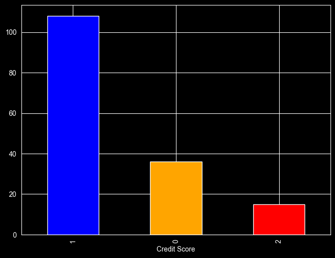
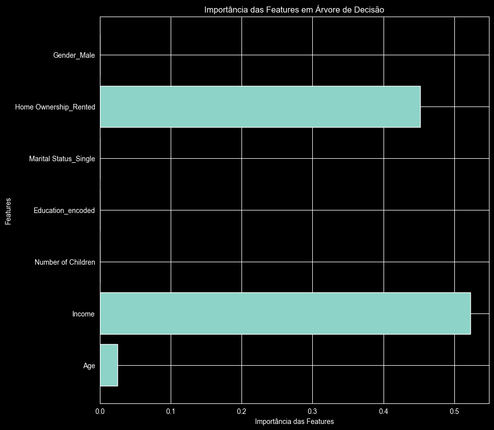

# Classificação de Score de Crédito

Projeto de Ciência de Dados desenvolvido ao longo do curso **Profissão: Cientista de Dados (EBAC)**, como entrega do **Programa de Parceria com a Semantix**.

O objetivo é prever o **score de crédito** de clientes (Alto, Médio ou Baixo) a partir de características demográficas e financeiras, usando modelos de classificação supervisionada.

---

## 1. O problema de negócio

Instituições financeiras precisam decidir, todos os dias, para quem conceder crédito e em quais condições. Essa decisão depende de uma estimativa do risco de inadimplência de cada cliente. Errar para um lado gera prejuízo com calotes; errar para o outro significa recusar bons clientes e perder receita.

Um modelo de **credit score** transforma informações do cliente (idade, renda, escolaridade, situação de moradia etc.) em uma classificação de risco. Com isso, a instituição consegue:

- padronizar e acelerar a análise de crédito;
- reduzir a exposição a clientes de alto risco;
- identificar perfis de bom pagador que mereceriam condições melhores.

Neste projeto, o alvo é a variável **Credit Score**, com três classes: `High`, `Average` e `Low`.

## 2. Origem dos dados

A base `credit_score.csv` foi fornecida pela EBAC para o projeto de Credit Score do curso. Ela não contém dados pessoais identificáveis.

| Coluna | Descrição | Tipo |
|---|---|---|
| `Age` | Idade do cliente | numérica |
| `Gender` | Gênero | categórica (Female / Male) |
| `Income` | Renda anual | numérica |
| `Education` | Escolaridade | categórica (5 níveis) |
| `Marital Status` | Estado civil | categórica (Single / Married) |
| `Number of Children` | Número de filhos | numérica |
| `Home Ownership` | Tipo de moradia | categórica (Owned / Rented) |
| `Credit Score` | **Variável alvo** | categórica (High / Average / Low) |

164 registros e 8 colunas no arquivo original.

## 3. Pipeline do projeto

```
Coleta  →  Pré-processamento  →  Análise exploratória  →  Codificação e balanceamento  →  Modelagem  →  Avaliação
```

| Etapa | Notebook | O que é feito |
|---|---|---|
| 1 | [`01_preprocessamento_e_eda.ipynb`](notebooks/01_preprocessamento_e_eda.ipynb) | Tipagem, valores faltantes, outliers, análises univariada e bivariada, correlação, codificação de categóricas, separação treino/teste e balanceamento com SMOTE |
| 2 | [`02_modelo_naive_bayes.ipynb`](notebooks/02_modelo_naive_bayes.ipynb) | Treino e avaliação de um classificador Naive Bayes Gaussiano |
| 3 | [`03_modelo_arvore_decisao.ipynb`](notebooks/03_modelo_arvore_decisao.ipynb) | Treino e avaliação de uma Árvore de Decisão, visualização da árvore, importância das features e modelo reduzido |

A documentação completa, com as justificativas de cada decisão, está em [`docs/documentacao_tecnica.md`](docs/documentacao_tecnica.md).

## 4. Principais resultados

### Análise exploratória

- Renda cresce com a idade (correlação de 0,61).
- Clientes com **casa própria** concentram-se quase totalmente na classe de score alto.
- Escolaridade mais alta (mestrado e doutorado) está associada a scores altos; formações básicas, a scores baixos.
- A base é **desbalanceada**: 68 % dos clientes têm score `High`, 23 % `Average` e 9 % `Low`.

<p align="center">
  
</p>

### Modelos

Avaliação na base de teste (40 registros, sem balanceamento):

| Modelo | Acurácia | Recall (macro) | Observações |
|---|---|---|---|
| Naive Bayes Gaussiano | 100 % | 1,00 | 98,8 % de acurácia no treino |
| Árvore de Decisão (Gini) | 97,5 % | 0,99 | Profundidade 7; 1 erro em 40 |
| Árvore de Decisão (2 features) | 92,5 % | 0,91 | Apenas `Income` e `Home Ownership` |

As duas features mais importantes para a árvore foram **renda** (`Income`) e **tipo de moradia** (`Home Ownership_Rented`), o que confirma os padrões vistos na análise exploratória.

<p align="center">
  
</p>

### Conclusão

Ambos os modelos atingiram desempenho muito alto nesta base. A Árvore de Decisão foi escolhida como modelo final por ser **interpretável** (as regras de decisão podem ser lidas diretamente na árvore), ter baixo custo computacional e manter resultado praticamente equivalente ao Naive Bayes. As métricas próximas de 100 % indicam que a base é pequena e bem separável; a seção de conclusões da documentação técnica discute as limitações e os próximos passos.

## 5. Estrutura do repositório

```
semantix-data-science/
├── README.md
├── requirements.txt
├── data/
│   ├── raw/credit_score.csv              ← base original
│   └── processed/                        ← bases de treino (balanceada) e teste geradas no notebook 01
├── notebooks/
│   ├── 01_preprocessamento_e_eda.ipynb
│   ├── 02_modelo_naive_bayes.ipynb
│   └── 03_modelo_arvore_decisao.ipynb
├── docs/
│   ├── documentacao_tecnica.md           ← coleta, EDA, modelagem, avaliação, conclusões e justificativas
│   └── apresentacao.pdf                  ← apresentação visual dos resultados
└── images/                               ← gráficos exportados dos notebooks
```

## 6. Como executar

```bash
git clone https://github.com/SEU-USUARIO/semantix-data-science.git
cd semantix-data-science
pip install -r requirements.txt
jupyter notebook
```

Execute os notebooks na ordem numérica, a partir da pasta `notebooks/`. O notebook 01 regenera os arquivos de `data/processed/` usados pelos notebooks 02 e 03.

## 7. Tecnologias

Python · pandas · NumPy · scikit-learn · imbalanced-learn (SMOTE) · Matplotlib · Seaborn · Plotly

## 8. Autor

**João Mateus Almeida**
Projeto desenvolvido no curso Profissão: Cientista de Dados — EBAC.
