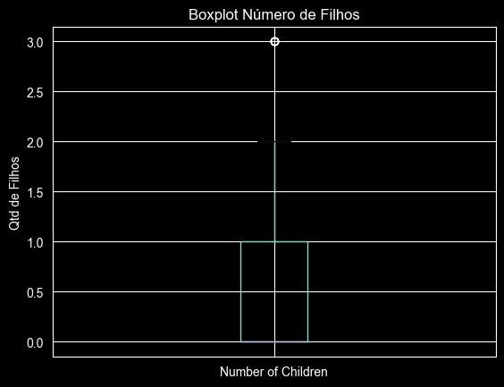
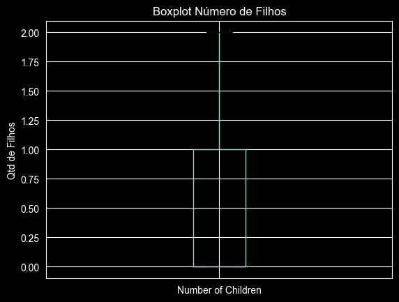
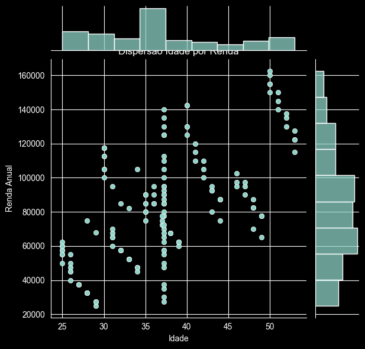
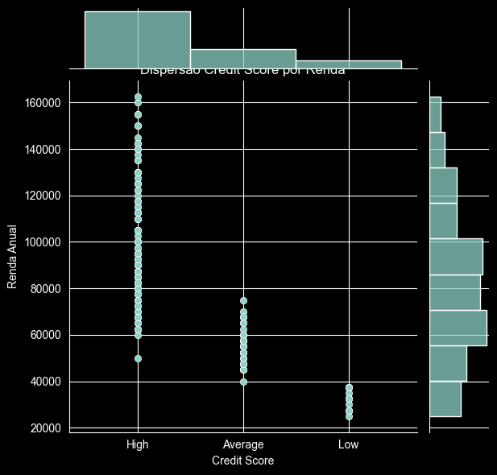
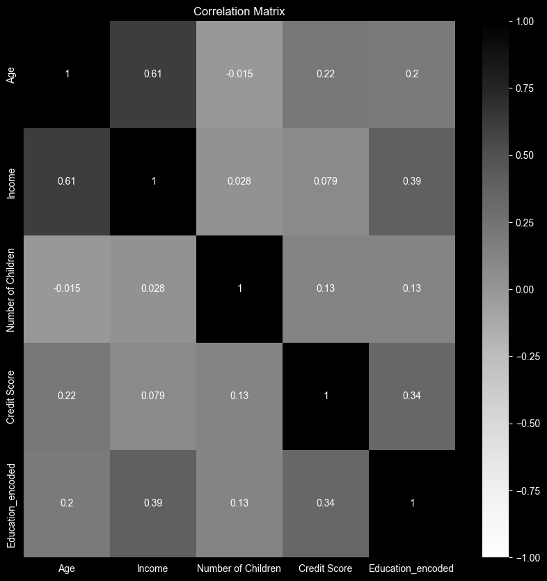

# Documentação Técnica — Classificação de Score de Crédito

Projeto de Parceria Semantix · Curso Profissão: Cientista de Dados (EBAC)
Autor: João Mateus Almeida

---

## Sumário

1. [Contexto e objetivo](#1-contexto-e-objetivo)
2. [Coleta de dados](#2-coleta-de-dados)
3. [Pré-processamento](#3-pré-processamento)
4. [Análise exploratória de dados (EDA)](#4-análise-exploratória-de-dados-eda)
5. [Preparação para modelagem](#5-preparação-para-modelagem)
6. [Modelagem](#6-modelagem)
7. [Avaliação e comparação dos modelos](#7-avaliação-e-comparação-dos-modelos)
8. [Conclusões](#8-conclusões)
9. [Limitações e próximos passos](#9-limitações-e-próximos-passos)

---

## 1. Contexto e objetivo

O *credit score* é uma pontuação que representa a credibilidade de um indivíduo quanto ao cumprimento de obrigações financeiras. Instituições financeiras usam essa pontuação para decidir sobre a concessão de crédito e suas condições.

**Objetivo do projeto:** construir um modelo de classificação capaz de prever a classe de score de crédito de um cliente (`High`, `Average` ou `Low`) a partir de suas características demográficas e financeiras.

**Por que isso é relevante:** um modelo preditivo permite avaliar risco de forma padronizada e escalável, reduzindo tanto a concessão de crédito a clientes de alto risco quanto a recusa indevida de bons pagadores.

---

## 2. Coleta de dados

### 2.1 Fonte

Base `credit_score.csv` fornecida pela EBAC para o projeto de Credit Score do curso. Arquivo CSV com separador `;`, 164 registros e 8 colunas.

### 2.2 Dicionário de dados

| Coluna | Descrição | Tipo original | Observações |
|---|---|---|---|
| `Age` | Idade do cliente | float | 34 valores faltantes (20,7 %) |
| `Gender` | Gênero | texto | Female / Male |
| `Income` | Renda anual | texto | Formato brasileiro (`50.000,00`), exigiu conversão |
| `Education` | Escolaridade | texto | High School Diploma, Associate's, Bachelor's, Master's, Doctorate |
| `Marital Status` | Estado civil | texto | Single / Married |
| `Number of Children` | Número de filhos | inteiro | 0 a 3 |
| `Home Ownership` | Tipo de moradia | texto | Owned / Rented |
| `Credit Score` | **Variável alvo** | texto | High (113), Average (36), Low (15) |

---

## 3. Pré-processamento

Notebook: `01_preprocessamento_e_eda.ipynb`, Etapa 1.

### 3.1 Tipos de dados

A coluna `Income` chegou como texto no formato `50.000,00`. Foi convertida para numérico removendo o separador de milhar e a vírgula decimal, e dividindo por 100 para restaurar a escala correta (ex.: `50.000,00` → `50000.0`).

`Number of Children` foi forçada para numérico com `pd.to_numeric(errors='coerce')`, garantindo que qualquer valor inválido fosse tratado como nulo.

### 3.2 Valores faltantes

Apenas `Age` tinha valores ausentes: 34 registros, ou 20,7 % da base.

**Decisão:** imputação pela **média** da coluna (≈ 37,2 anos).

**Justificativa:** excluir as linhas significaria perder um quinto de uma base que já é pequena (164 registros). A análise univariada mostrou que `Age` tem distribuição aproximadamente simétrica, sem outliers, o que torna a média um valor representativo e de baixo risco de distorção. A imputação foi feita **depois** da remoção de outliers e da análise univariada, para que a média não fosse contaminada por valores extremos.

### 3.3 Consistência das categóricas

Os valores únicos de `Gender`, `Education`, `Marital Status` e `Home Ownership` foram inspecionados. Não havia erros de digitação, variações de capitalização ou categorias duplicadas; nenhum tratamento foi necessário.

### 3.4 Outliers

Boxplots das três variáveis numéricas mostraram que `Age` e `Income` não apresentavam outliers. `Number of Children` apresentava 5 registros com valor 3, identificados como outliers pelo critério do boxplot.

**Decisão:** remover os 5 registros.

**Justificativa:** os 5 casos representavam 3 % da base e tinham perfil idêntico (mulheres de 45 anos, casadas, com casa própria e score alto), o que sugere registros repetidos ou artificiais. Por serem poucos e homogêneos, a remoção não compromete a representatividade da base, e evita que a variável ganhe uma cauda que não reflete os demais clientes. A base passou de 164 para 159 registros.

| Boxplot antes | Boxplot depois |
|---|---|
|  |  |

---

## 4. Análise exploratória de dados (EDA)

Notebook: `01_preprocessamento_e_eda.ipynb`, Etapa 2.

### 4.1 Análise univariada

Estatísticas descritivas das variáveis numéricas (antes da imputação de `Age`):

| | Age | Income | Number of Children |
|---|---|---|---|
| média | 37,5 | 83.765 | 0,65 |
| desvio padrão | 8,5 | 32.457 | 0,88 |
| mínimo | 25 | 25.000 | 0 |
| mediana | 36 | 83.750 | 0 |
| máximo | 53 | 162.500 | 3 |

**Observações:**
- `Age` e `Income` têm distribuições aproximadamente normais (média e mediana muito próximas).
- `Number of Children` é concentrada em zero: mais da metade dos clientes não tem filhos.
- `Marital Status` está equilibrada entre solteiros e casados.

### 4.2 Análise bivariada

Cinco perguntas propostas pelo projeto e três adicionais, respondidas com gráficos de barras empilhadas (Plotly) e gráficos de dispersão (Seaborn).

| # | Pergunta | Resposta encontrada |
|---|---|---|
| 1 | Existe relação entre idade e estado civil? | Sim. Os casados concentram-se nas idades acima de 45 anos; os mais jovens são majoritariamente solteiros. |
| 2 | Qual a relação entre score e escolaridade? | Clara. Formações básicas (ensino médio, *associate*) estão associadas a score baixo; mestrado e doutorado, a score alto. |
| 3 | A renda influencia a idade? | Sim. Há correlação positiva: idades mais avançadas têm renda anual maior. |
| 4 | A renda influencia o score? | Sim. Clientes com maiores rendas tendem a ter score mais alto. |
| 5 | Clientes com casa própria têm score mais alto? | Fortemente. Pouco mais de 98 % dos clientes com casa própria têm score alto. |
| 6 | Existe relação entre gênero e score? | Na base, os homens aparecem apenas nas classes média e alta; a classe baixa é composta só por mulheres. |
| 7 | Existe relação entre número de filhos e score? | A classe de score baixo é formada por clientes sem filhos. |
| 8 | Existe relação entre estado civil e score? | Quase todos os casados têm score alto. |

| Idade × Renda | Score × Renda |
|---|---|
|  |  |

### 4.3 Correlação

Matriz de correlação (Pearson) das variáveis numéricas, antes e depois da codificação das categóricas:



- `Age` × `Income`: **0,61** — a correlação mais alta da base, coerente com a progressão de renda ao longo da carreira.
- `Education_encoded` × `Income`: 0,39 e `Education_encoded` × `Credit Score`: 0,34 — escolaridade se relaciona tanto com renda quanto com o alvo.
- Nenhuma correlação forte o bastante para justificar a remoção de variáveis por multicolinearidade.

---

## 5. Preparação para modelagem

Notebook: `01_preprocessamento_e_eda.ipynb`, Etapa 3.

### 5.1 Codificação das variáveis categóricas

Duas técnicas foram combinadas, de acordo com a natureza de cada variável:

| Variável | Técnica | Justificativa |
|---|---|---|
| `Education` | **Label Encoding** → `Education_encoded` | Há uma ordem natural entre os níveis de escolaridade. Um único inteiro preserva essa noção de progressão. |
| `Credit Score` (alvo) | **Label Encoding** | Modelos do scikit-learn esperam o alvo como inteiro. |
| `Marital Status` | **One-Hot** com `drop_first=True` → `Marital Status_Single` | Binária, sem ordem. |
| `Home Ownership` | **One-Hot** com `drop_first=True` → `Home Ownership_Rented` | Binária, sem ordem. |
| `Gender` | **One-Hot** com `drop_first=True` → `Gender_Male` | Binária, sem ordem. |

O `drop_first=True` evita a coluna redundante (se `Gender_Male = 0`, o cliente é `Female`), o que previne multicolinearidade perfeita.

**Mapeamento do alvo gerado pelo `LabelEncoder`** (ordem alfabética):

| Código | Classe |
|---|---|
| 0 | Average |
| 1 | High |
| 2 | Low |

Esse mapeamento é necessário para interpretar as matrizes de confusão e os relatórios de classificação dos notebooks 02 e 03.

Após a codificação, a coluna original `Education` foi descartada. As features finais são 7: `Age`, `Income`, `Number of Children`, `Education_encoded`, `Marital Status_Single`, `Home Ownership_Rented`, `Gender_Male`.

### 5.2 Separação treino / teste

`train_test_split` com `test_size=0.25` e `random_state=42`:

| Conjunto | Registros |
|---|---|
| Treino | 119 |
| Teste | 40 |

### 5.3 Balanceamento das classes

Distribuição do alvo na base completa:

| Classe | Proporção |
|---|---|
| High (1) | 67,9 % |
| Average (0) | 22,6 % |
| Low (2) | 9,4 % |


A base é claramente desbalanceada: um modelo que sempre previsse `High` acertaria 68 % das vezes sem aprender nada. A classe `Low`, justamente a de maior risco para o negócio, é a menos representada.

**Decisão:** aplicar **SMOTE** (Synthetic Minority Over-sampling Technique) com `random_state=42`, **apenas na base de treino**.

**Justificativa:**
- O SMOTE gera exemplos sintéticos das classes minoritárias por interpolação entre vizinhos, em vez de simplesmente duplicar linhas, o que reduz o risco de o modelo decorar registros.
- O balanceamento é feito somente no treino porque a base de teste deve refletir a distribuição real dos dados. Balancear o teste produziria métricas artificialmente otimistas e que não se repetiriam em produção.

Resultado: treino balanceado com **81 registros por classe** (243 no total). O teste permaneceu com 40 registros na proporção original (27 High, 9 Average, 4 Low).

As quatro bases resultantes (`X_train_balanced`, `y_train_balanced`, `X_test`, `y_test`) foram salvas em `data/processed/` e são a entrada dos notebooks de modelagem.

---

## 6. Modelagem

Dois algoritmos de classificação foram aplicados sobre as mesmas bases, permitindo comparação direta.

### 6.1 Naive Bayes Gaussiano

Notebook: `02_modelo_naive_bayes.ipynb`.

**O que é:** classificador probabilístico baseado no teorema de Bayes, que assume independência condicional entre as features e distribuição normal para cada uma delas. Calcula a probabilidade de cada classe dado o vetor de features e escolhe a mais provável.

**Por que foi escolhido:** é rápido, exige poucos dados para treinar, lida naturalmente com múltiplas classes e serve como *baseline* sólido para comparação. A suposição de normalidade é razoável para `Age` e `Income`, que mostraram distribuição aproximadamente normal na EDA.

**Implementação:** `GaussianNB()` do scikit-learn, com os hiperparâmetros padrão, treinado em `X_train_balanced` / `y_train_balanced`.

### 6.2 Árvore de Decisão

Notebook: `03_modelo_arvore_decisao.ipynb`.

**O que é:** modelo que aprende uma sequência de regras do tipo "se `Income` for menor que determinado valor, então…", dividindo os dados recursivamente até separar as classes. O critério de **Gini** mede a impureza de cada nó e escolhe a divisão que mais reduz essa impureza.

**Por que foi escolhido:** é altamente interpretável (as regras podem ser lidas e explicadas a um gestor de crédito), não exige padronização das features e captura relações não lineares.

**Implementação:** `DecisionTreeClassifier(criterion='gini', random_state=0)`, sem limite de profundidade, treinado nas mesmas bases.

**Análises adicionais realizadas:**
- Visualização da árvore completa com `plot_tree` — a árvore final tem **profundidade 7**.
- Importância das features (`feature_importances_`): as duas mais relevantes foram **`Income`** e **`Home Ownership_Rented`**, em linha com a EDA.
- Treino de um **modelo reduzido** apenas com essas duas features, para medir quanto do desempenho elas explicam sozinhas.


---

## 7. Avaliação e comparação dos modelos

Métricas utilizadas: **acurácia** (proporção total de acertos), **recall macro** (média do recall de cada classe, sem ponderar pelo tamanho — adequado para bases desbalanceadas, porque dá o mesmo peso à classe `Low`) e **matriz de confusão**.

### 7.1 Naive Bayes

| Conjunto | Acurácia | Recall macro |
|---|---|---|
| Treino (balanceado) | 98,8 % | 0,988 |
| Teste | 100 % | 1,000 |

Matriz de confusão no treino (linhas = real, colunas = previsto; ordem 0-Average, 1-High, 2-Low):

```
[[79  0  2]
 [ 1 80  0]
 [ 0  0 81]]
```

Apenas 3 erros em 243 registros de treino; nenhum erro nos 40 de teste. O desempenho ligeiramente menor no treino do que no teste indica que o modelo generaliza bem e não está sobreajustado.

### 7.2 Árvore de Decisão

Relatório de classificação na base de teste:

| Classe | Precisão | Recall | F1 | Suporte |
|---|---|---|---|---|
| 0 — Average | 0,90 | 1,00 | 0,95 | 9 |
| 1 — High | 1,00 | 0,96 | 0,98 | 27 |
| 2 — Low | 1,00 | 1,00 | 1,00 | 4 |
| **Acurácia** | | | **0,975** | 40 |
| Média macro | 0,97 | 0,99 | 0,98 | |

Um único erro em 40 registros: um cliente `High` classificado como `Average`. A classe `Low`, a mais crítica para o negócio, foi identificada perfeitamente.

### 7.3 Árvore de Decisão reduzida (2 features)

| Classe | Precisão | Recall | F1 | Suporte |
|---|---|---|---|---|
| 0 — Average | 0,88 | 0,78 | 0,82 | 9 |
| 1 — High | 0,93 | 0,96 | 0,95 | 27 |
| 2 — Low | 1,00 | 1,00 | 1,00 | 4 |
| **Acurácia** | | | **0,925** | 40 |

Com apenas renda e tipo de moradia, o modelo manteve 92,5 % de acurácia. A perda concentrou-se na classe `Average`, que exige as demais variáveis para ser separada de `High`. Conclusão: as duas features explicam a maior parte do problema, mas o modelo completo é preferível.

### 7.4 Comparação

| Modelo | Acurácia (teste) | Recall macro (teste) | Interpretabilidade | Custo |
|---|---|---|---|---|
| Naive Bayes | 100 % | 1,00 | Baixa | Muito baixo |
| Árvore de Decisão | 97,5 % | 0,99 | **Alta** | Baixo |
| Árvore reduzida | 92,5 % | 0,91 | Muito alta | Muito baixo |

---

## 8. Conclusões

1. **Os dois modelos atingiram desempenho muito alto** nesta base, com diferença de um único registro no teste. Em termos puramente numéricos, o Naive Bayes foi marginalmente superior.

2. **A Árvore de Decisão é o modelo recomendado** para o problema de negócio. A diferença de desempenho é desprezível, e a árvore oferece o que uma área de crédito mais precisa: **regras explícitas e auditáveis**. É possível mostrar a um gestor, ou a um órgão regulador, exatamente por que um cliente recebeu determinada classificação. O Naive Bayes, por ser probabilístico, não oferece essa transparência.

3. **Renda e tipo de moradia são os fatores decisivos**, seguidos de escolaridade. Isso é coerente com a lógica de crédito: capacidade de pagamento (renda) e patrimônio (casa própria) são os sinais mais diretos de baixo risco.

4. **O pré-processamento foi determinante.** Sem o SMOTE, a classe `Low` (9 % da base) teria sido sub-representada no treino, e é justamente a classe que a instituição mais precisa acertar.

---

## 9. Limitações e próximos passos

- **Tamanho da base.** 159 registros após limpeza e apenas 40 no teste. Com 4 exemplos da classe `Low` no teste, um único erro mudaria o recall dessa classe de 100 % para 75 %. As métricas devem ser lidas como indicativas, não como garantia de desempenho em produção.

- **Separabilidade da base.** Métricas próximas de 100 % em dois algoritmos tão diferentes sugerem que as classes são quase linearmente separáveis nesta base — o que é comum em bases didáticas e raro em dados reais de crédito. Em produção, espera-se desempenho menor.

- **Validação.** Os resultados vêm de uma única divisão treino/teste. O próximo passo natural é aplicar **validação cruzada** (k-fold) para obter uma estimativa mais estável, e **busca de hiperparâmetros** (`max_depth`, `min_samples_leaf`) na árvore para reduzir o risco de sobreajuste — a profundidade 7 em uma base de 243 registros é um sinal de alerta.

- **Modelos adicionais.** Random Forest e XGBoost tendem a superar uma árvore única em bases maiores e podem ser avaliados quando houver mais dados.

- **Variáveis.** A base não contém histórico de pagamentos, endividamento ou tempo de relacionamento, que são as variáveis mais preditivas em modelos de crédito reais. A inclusão dessas informações seria o maior ganho possível para o modelo.
